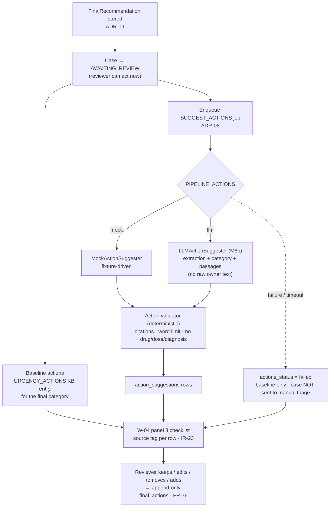

# ADR-18: Suggested actions per urgency level — baseline plus LLM-tailored

- **Status:** Accepted
- **Date:** 2026-10-10
- **Requirements:** FR-28 (revised), FR-71 to FR-79, NFR-29, NFR-30, IR-23, BR-10, DR-09, SR-17
- **Related:** ADR-05, ADR-08, ADR-09, ADR-14, ADR-15, ADR-17

## Context

PD1 lists "Suggested Actions — recommends actions based on the urgency level" as
a core feature, and the general objective is a system that recommends "a
Veterinary Triage List urgency category **and suggested actions**". A category
on its own tells staff how long a patient may wait, not what to do while they
wait.

Three constraints shape the design.

1. **PD1 also states the system "does not diagnose conditions or prescribe
   treatments."** SRS v1.0 encoded this as FR-28, which forbade any "treatment
   recommendation" — wording that contradicted the feature outright.
2. **Latency.** The pipeline already makes two model calls inside a 10-second
   median budget (NFR-01). A third call in the same job would break it.
3. **Reliability.** A missing action list must never stop a case being triaged,
   and every one of the five categories must show something useful even when the
   model is unavailable.

## Decision

### 1. Narrow the prohibition instead of dropping the feature

FR-28 now forbids diagnosis, prognosis, medication names, dose expressions and
treatment protocols. Actions are **triage-level handling only**: escalate,
prepare, monitor, what to ask the owner, transport precautions.

> In scope: "Prepare oxygen and alert the veterinarian immediately."
> Out of scope: "Give butorphanol 0.2 mg/kg IV."

### 2. Two layers, so every category always has actions

| Layer | Source | Always present? |
|---|---|---|
| **Baseline** | An `URGENCY_ACTIONS` knowledge-base entry, one per VTL category | Yes — deterministic lookup by category |
| **Tailored** | Up to `ACTIONS_MAX_ITEMS` (default 5) LLM actions grounded in the retrieved passages | No — best effort |

Baseline sets are **knowledge-base entries, not a configuration file**. PD1
requires urgency-level actions to be curated reference data with source metadata
and versioning, and this gives them the citation, approval and version
machinery of ADR-14 for free. `kb_entries` gains `kind`
(`COMPLAINT` | `URGENCY_ACTIONS`) and `urgency_category`.
`URGENCY_ACTIONS` entries are looked up by category and **excluded from
similarity search**, so they never displace clinical passages in retrieval.

### 3. A separate background job, after the recommendation

The orchestrator stores the recommendation, sets the case to `AWAITING_REVIEW`,
and **enqueues a `SUGGEST_ACTIONS` job**. The reviewer sees the category
immediately; tailored actions arrive shortly afterwards (NFR-29). Failure of
that job leaves the case at `AWAITING_REVIEW` with baseline actions shown and
`actions_status = failed` — never `MANUAL_TRIAGE_REQUIRED` (FR-77).

### 4. A deterministic validator, as with the safety floor

`app/pipeline/action_validator.py` is pure, testable code. Every tailored action
must pass:

1. at least one citation that exists in the retrieved passages (as FR-22);
2. a word limit (25 words);
3. no medication name (block list), no dose pattern
   (`mg/kg`, `mL`, `IV`, `IM`, `SC`, `q8h`, …), no diagnosis term.

Rejected actions are counted and never displayed. The model's text is never
trusted into the UI unchecked (SR-17).

### 5. The actions call never sees the raw owner description

Its inputs are the structured extraction, the final category and the retrieved
passages. This keeps the privacy boundary of ADR-10 and shrinks the
prompt-injection surface.

### 6. The reviewer finalizes

The reviewer keeps, edits, removes or adds actions and finalizes the list with
the decision. Suggestions are preserved in `action_suggestions`; the outcome is
written to append-only `final_actions` with a per-item status (DR-09). If the
reviewer changes the category, the baseline set switches immediately and the
tailored actions are marked outdated (FR-78).

## Consequences

**Positive**

- The system delivers the PD1 feature without ever naming a drug or a dose; the
  boundary is enforced by code, not only by prompt wording.
- Every category has actions even with the LLM switched off entirely, so the
  feature is demonstrable in mock mode and survives an outage mid-demo.
- The recommendation latency budget (NFR-01) is untouched, because the third
  model call is outside that job.
- Baseline actions inherit citations, approval and versioning from the knowledge
  base, which satisfies PD1's "source metadata and versioning" for this content.
- Reviewer edits are recorded, which directly supplies PD1 objective 3
  (suggested-action appropriateness): keep/edit/remove rates are a usable metric.

**Negative**

- A third model call raises cost and token use by roughly 50% per case; M2's
  budget estimate must be revised.
- Two-stage arrival (category now, actions shortly after) is a more complex UI
  state than a single payload, and needs its own polling field.
- The block list will reject some legitimate phrasing — "monitor breathing rate"
  is fine, but a sentence mentioning oxygen *flow rates* may trip the dose
  pattern. False rejections are safer than false acceptances here, and the
  rejected count is surfaced so the prompt can be tuned.
- Tailored actions can become outdated when a reviewer changes the category,
  which adds a state the UI must display honestly rather than hide.

## Alternatives considered

| Option | Why rejected |
|---|---|
| Generate actions in the same LLM call as the category | A malformed action list would then invalidate the category too, and it would push the pipeline past the NFR-01 median |
| Baseline actions only, no LLM | Does not meet PD1 objective 2, which asks the LLM/RAG pipeline to recommend the actions; generic text per category adds little over a printed poster |
| LLM actions only, no baseline | Three of five categories would be empty whenever the model failed, and the mock-mode demo would show nothing |
| Store baseline actions in `knowledge_base/urgency_actions.yaml` | Was the first design; rejected because PD1 requires urgency-level actions to be curated reference data with source metadata and versioning, which the KB already provides |
| Let the system finalize low-urgency actions automatically | Contradicts BR-01 and BR-10; an unchecked Blue-category action list is exactly the quiet failure to avoid |

## Note on clinical validation

BR-04 keeps a single approval gate, and `URGENCY_ACTIONS` entries pass through
it like any other clinical content. For this academic project, external
veterinary sign-off has been waived by the professor: entries must instead be
traceable to a published, veterinarian-authored source, and the absence of
clinical validation is reported as a limitation of the evaluation. The approval
workflow itself is unchanged, so a real deployment restores the original
control by granting `can_approve_kb` to a licensed veterinarian.
